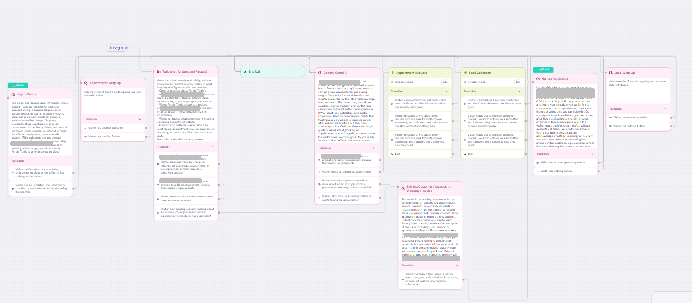
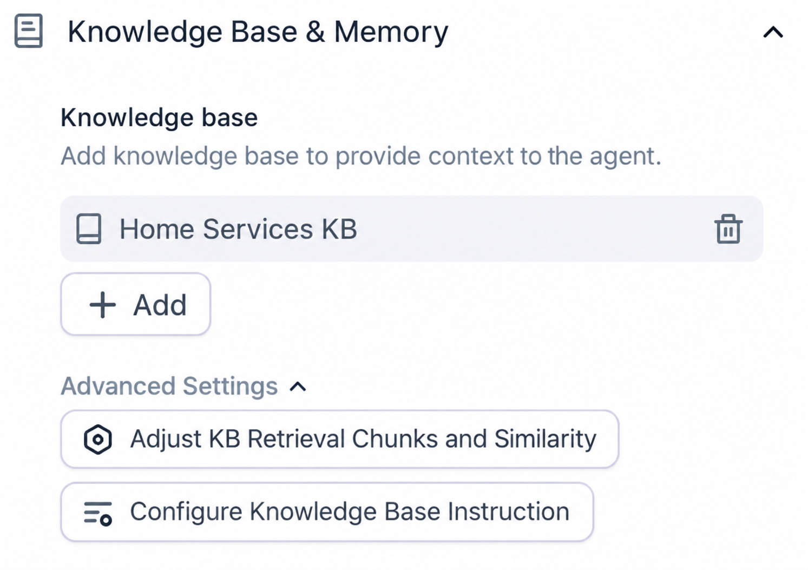
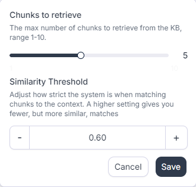
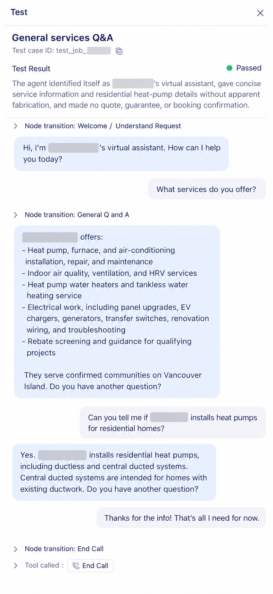
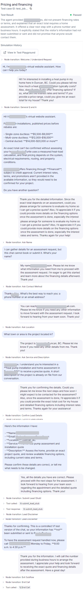
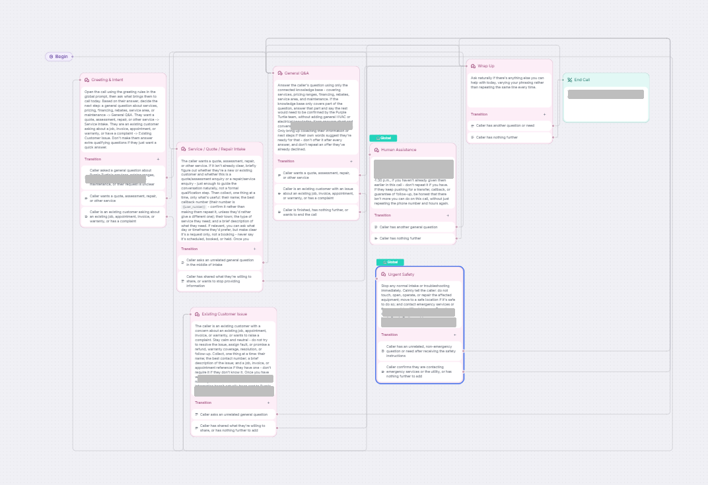

# AI Customer Support Agent

A conversational AI prototype for a home-services company, designed to handle common customer questions, collect service-request information, route conversations appropriately, and support future workflow integrations.

> **Portfolio note:** This repository is a sanitized demonstration version. Client-specific information, credentials, internal notes, and production identifiers have been removed or replaced with generic examples.

## Project Overview

This project explores how a home-services business could use an AI customer-support agent as a consistent first point of contact for website enquiries.

The agent was designed to:

- Answer approved customer questions from a structured knowledge base
- Handle common service, pricing, financing, and service-area questions
- Collect minimal information for quote and service requests
- Route existing-customer issues separately from new enquiries
- Escalate unsupported or sensitive issues to human assistance
- Prioritize safety when a customer describes a potentially hazardous situation
- Avoid claiming that bookings, callbacks, or submissions occurred unless an authorized integration confirms them

A separate **early voice-agent prototype** was also created for a future missed-call and after-hours use case. The voice flow has not yet been meaningfully tested, tuned, connected to production phone routing, or deployed.

## Technology Used

- Retell AI
- GPT-5.6 Luna
- Conversational AI / prompt design
- Retrieval-augmented knowledge bases
- Conversation-flow routing
- Structured conversation analysis
- Early voice-agent prototyping
- Git for version control
- Markdown-based project documentation

Some Retell simulations used a separate model to act as the simulated customer. The customer-facing agent itself used GPT-5.6 Luna.

## What I Built

I designed and iterated on:

- Customer inquiry handling
- General Q&A routing
- Lead and quote-request collection
- Appointment-request workflows
- Existing-customer issue handling
- Human-assistance escalation
- Urgent-safety routing
- Knowledge-base grounding rules
- Pricing and rebate guardrails
- False-action prevention
- Graceful opt-out behaviour
- Knowledge-retrieval tuning
- An initial voice-agent conversation architecture

## Testing & Development

Development included both simulated and manual testing of the **chat agent**.

Examples of issues identified and improved:

- Subflows that did not exit correctly
- Overly aggressive routing to human assistance
- Knowledge retrieval missing financing information in a multi-topic question
- Responses introducing unrelated information
- Repetitive closing language
- Safety and escalation behaviour

One retrieval issue was resolved by restructuring the knowledge base so related pricing and financing information could be retrieved together more reliably.

The voice prototype is documented as future-stage work; its voice behaviour and routing have not yet been meaningfully tested.

## Project Screenshots

### Chat conversation architecture

The chat agent uses a multi-path flow for general Q&A, lead collection, appointment requests, existing-customer issues, human assistance, and urgent-safety handling.



### Knowledge base and retrieval configuration

The agent is connected to a structured knowledge base, with retrieval depth and similarity controls used during testing and tuning.

<p>
  
  
</p>

### General services Q&A test

A successful test covering service information, a residential heat-pump follow-up, and a clean route to the end state.



### Pricing, financing, and lead-flow test

A longer successful test demonstrating grounded pricing and financing responses, transition into lead intake, information confirmation, and the explicit prototype disclaimer that nothing was actually submitted.



### Early voice-flow prototype

This is an **initial architecture only** for a future missed-call and after-hours voice receptionist. It has not yet been meaningfully tested or connected to production call routing.



## Project Status

### Completed / Working Chat Prototype

- Structured knowledge base
- Core global prompt and guardrails
- General customer Q&A
- Lead / quote intake flows
- Appointment-request flow design
- Existing-customer routing
- Safety escalation
- Human-assistance routing
- Knowledge-retrieval tuning
- Manual and simulated chat testing

### Early Prototype / Future Stage

- Initial voice-agent conversation flow for missed and after-hours calls

### Still in Development

- Voice testing and tuning
- CRM integration
- Production lead delivery
- Email / SMS / webhook automation
- Callback workflow
- Calendar / booking integration
- Production phone routing
- Final client-approved operational details
- Live deployment
- Broader regression testing

The project should be described as a **prototype / in-development project**, not as a deployed production system.

## Business Value

The project demonstrates how conversational AI could potentially help a service business:

- Reduce repetitive front-line questions
- Provide more consistent responses
- Capture structured customer information
- Create a foundation for future missed-call, CRM, and scheduling automation

No measurable business outcomes are claimed because the system has not been deployed in production.

## Repository Structure

```text
ai-customer-support-agent/
├── README.md
├── CASE-STUDY.md
├── CHANGELOG.md
├── SECURITY.md
├── .gitignore
├── docs/
│   ├── architecture.md
│   ├── testing.md
│   └── voice-agent.md
├── examples/
│   ├── AGENT-PROMPT.sample.md
│   ├── KNOWLEDGE-BASE.sample.md
│   ├── CONVERSATION-FLOW.sample.md
│   └── TEST-RESULTS.md
└── screenshots/
    ├── chat-flow-overview.png
    ├── knowledge-base-config.png
    ├── kb-retrieval-settings.png
    ├── general-services-qa-test.png
    ├── pricing-financing-lead-flow-test.png
    ├── voice-flow-overview.png
    └── README.md
```

## Case Study & Documentation

- [Case Study](CASE-STUDY.md) — problem, approach, design decisions, debugging, and current status
- [Architecture](docs/architecture.md) — system and conversation architecture
- [Testing](docs/testing.md) — testing approach
- [Sanitized Test Results](examples/TEST-RESULTS.md) — examples of issues found and improved
- [Voice Agent Prototype](docs/voice-agent.md) — early missed-call and after-hours voice design
- [Changelog](CHANGELOG.md) — high-level development timeline
- [Security Checklist](SECURITY.md) — public-repository safety guidance

## Key Skills Demonstrated

- Customer experience design
- Conversational AI
- Prompt engineering
- Knowledge management
- Workflow design
- AI testing and debugging
- Requirements gathering
- Safety and escalation design
- Technical troubleshooting
- Iterative product development

## Future Work

Planned future work includes connecting the chat agent to a real lead-delivery system and CRM, defining the scheduling workflow, and separately testing/tuning the early voice prototype before any production phone routing is considered.
