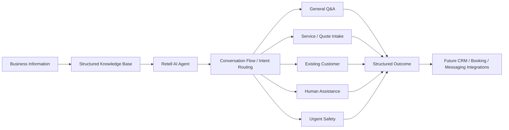

# Architecture

## High-Level Architecture



## Core Design Principles

### 1. Grounded answers only

The agent uses approved customer-facing information and does not fill unsupported company-specific gaps with generic industry knowledge.

### 2. No false actions

The assistant does not claim that a lead was submitted, an appointment was booked, a callback was arranged, or information was sent unless an authorized integration confirms it.

### 3. Safety takes priority

Immediate hazards override ordinary service, sales, and troubleshooting flows.

### 4. Minimal data collection

Only information relevant to the customer's current request is collected.

### 5. Human escalation when needed

Unsupported, sensitive, binding, or diagnostic questions move toward human assistance.

### 6. Voice and chat are different experiences

The voice prototype uses shorter turns, simpler spoken responses, and interruption-aware behaviour rather than reading chat-style responses aloud.

## Conversation Areas

- Greeting and intent identification
- General Q&A
- New-customer service / quote intake
- Appointment-request intent
- Existing-customer issue handling
- Human assistance
- Urgent safety
- Wrap-up

## Current Integration Boundary

The architecture intentionally stops before production actions.

```text
Customer
   ↓
AI Agent
   ↓
Structured information / conversation outcome
   ↓
[Future Integration Boundary]
   ↓
CRM / Email / SMS / Booking / Callback
```

Until that boundary is connected, the agent must not imply those actions occurred.
